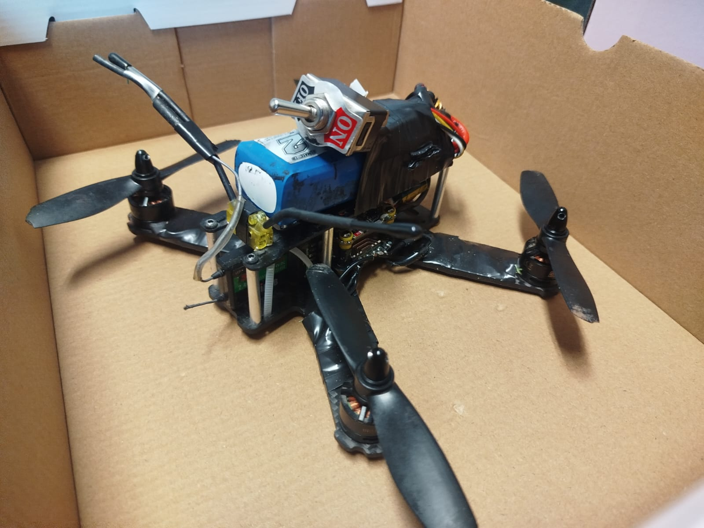
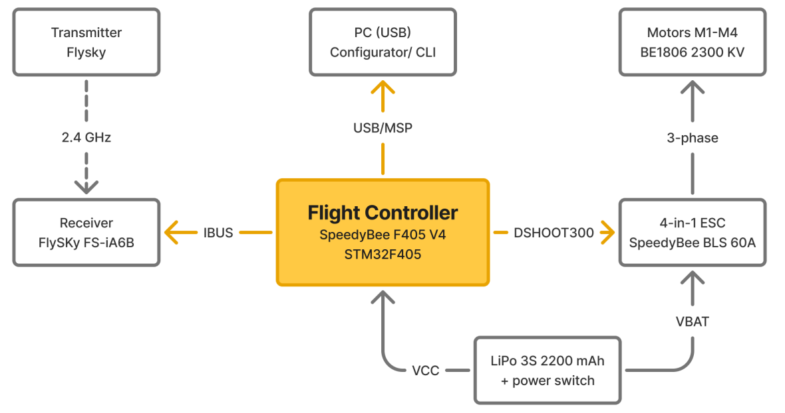

# IK-Dron

A 5" FPV racing drone (LS210 carbon-fiber frame) built, diagnosed and flown as a university electronics project. The drone originally shipped with a CC3D flight controller on LibrePilot, which suffered an unrecoverable microcontroller failure during testing — documented here is the migration to a modern SpeedyBee F405 V4 stack on BetaFlight 4.4.3, the full diagnostic process from BetaFlight's CLI, and the configuration that got it to a stable, controlled flight on October 13, 2026.

| Component | Spec |
|---|---|
| Frame | LS-210, 3K carbon fiber, 210 mm motor-to-motor |
| Flight controller | SpeedyBee F405 V4 (STM32F405, ICM42688P gyro, DPS310 baro) |
| ESC | SpeedyBee BLS 60A 4-in-1, DSHOT300 |
| Motors | FlashHobby BE1806, 2300 KV |
| Receiver | FlySky FS-iA6B, IBUS |
| Firmware | BetaFlight 4.4.3, target `SPEEDYBEEF405V4` |
| Total weight | 497 g |

## Docs

- [`docs/Reporte_Tecnico.pdf`](docs/Reporte_Tecnico.pdf) — technical report: system architecture, specs, firmware configuration, troubleshooting guide, safety procedures, and conclusions.
- [`docs/LogFile.pdf`](docs/LogFile.pdf) — full day-by-day build log (March–October 2026) with photos, incidents, and the reasoning behind each configuration change. Referenced throughout the technical report.
- [`docs/Reporte_Generacion1_2021.pdf`](docs/Reporte_Generacion1_2021.pdf) — the first-generation (2021) project report this one continues from, which selected the frame/motor/battery still in use and designed a custom STM32F446RE flight controller (later dropped in favor of commercial ones for cost reasons).

LaTeX sources for the first two are also included (`docs/*.tex`, `docs/sn-jnl.cls`, `docs/generalconfig.tex`, images under `docs/src/`) if you want to rebuild them.

## Scripts

- [`scripts/baud_rate_scanner.py`](scripts/baud_rate_scanner.py) — probes a serial port across common baud rates to find which one a connected flight controller responds on.

## What went wrong, briefly

The drone wouldn't lift off, then later took off with a jump and immediately disarmed. Both turned out to be physical/firmware mismatches: propellers mounted for the wrong rotation direction, and motor spin direction not matching BetaFlight's `yaw_motors_reversed` setting — which also trips BetaFlight's Runaway Takeoff protection. Full troubleshooting table with every flag/symptom/cause/fix is in the technical report.

## Credits

Built with [Orlando Contreras (DasReyxr)](https://github.com/DasReyxr) as a two-person team project, advised by Dr. Luis Antonio Raygoza Pérez — Department of Electronic Systems, Universidad Autónoma de Aguascalientes.
